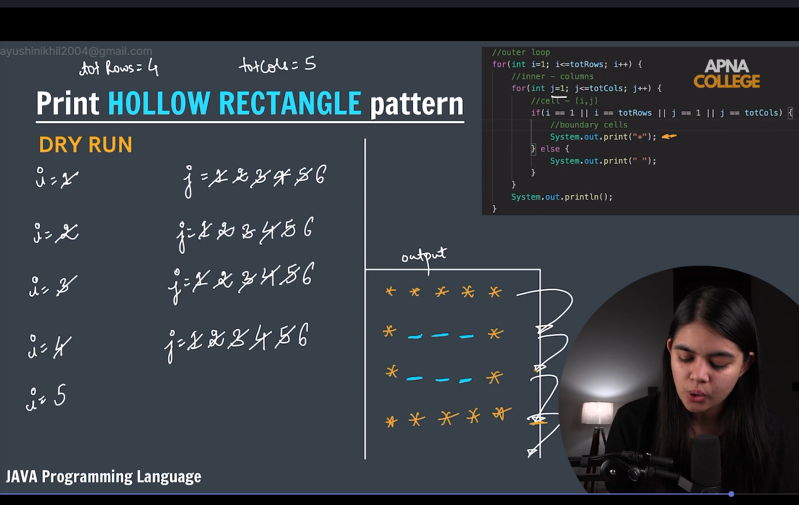
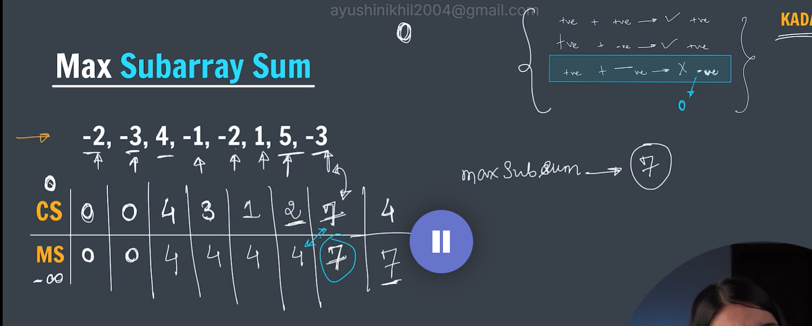

# DSA with Java

This directory contains topic-wise organized Data Structures & Algorithms implementations in Java.

## Structure

### 1. `1.basics/`
- [MultiplicationTable.java](1.basics/MultiplicationTable.java) - Multiplication table for a given number.
- [Factorial.java](1.basics/Factorial.java) - Factorial computation of a number.
- [PrimeNumbers.java](1.basics/PrimeNumbers.java) - Prime check ($n-1$ and optimized $\sqrt{n}$) & primes in range.
- [BinaryToDecimal.java](1.basics/BinaryToDecimal.java) - Binary to decimal conversion.
- [DecimalToBinary.java](1.basics/DecimalToBinary.java) - Decimal to binary conversion.
- [PalindromeNumber.java](1.basics/PalindromeNumber.java) - Number palindrome check.

### 2. `2.patterns/`
- [HollowRectangle.java](2.patterns/HollowRectangle.java) - Hollow rectangle star pattern.

  

- [InvertedRotatedHalfPyramid.java](2.patterns/InvertedRotatedHalfPyramid.java) - Inverted & rotated (right-aligned) half pyramid.
- [InvertedHalfPyramidNumbers.java](2.patterns/InvertedHalfPyramidNumbers.java) - Inverted half pyramid with numbers.
- [FloydsTriangle.java](2.patterns/FloydsTriangle.java) - Floyd's continuous counting number triangle.
- [ZeroOneTriangle.java](2.patterns/ZeroOneTriangle.java) - 0-1 alternating binary triangle pattern.
- [ButterflyPattern.java](2.patterns/ButterflyPattern.java) - Butterfly symmetrical star pattern.
- [SolidRhombus.java](2.patterns/SolidRhombus.java) - Solid tilted rhombus pattern.
- [HollowRhombus.java](2.patterns/HollowRhombus.java) - Hollow tilted rhombus pattern.
- [DiamondPattern.java](2.patterns/DiamondPattern.java) - Symmetrical diamond star pattern.

### 3. `3.arrays/`
- [UpdateArray.java](3.arrays/UpdateArray.java) - Passing arrays as arguments and updating elements by reference.
- [LinearSearch.java](3.arrays/LinearSearch.java) - Linear search algorithm on an integer array.
- [LinearSearchString.java](3.arrays/LinearSearchString.java) - Linear search algorithm on a String array.
- [LargestNumber.java](3.arrays/LargestNumber.java) - Finding the maximum/largest value in an array.
- [BinarySearch.java](3.arrays/BinarySearch.java) - Binary search on a sorted array $O(\log n)$.
- [ReverseArray.java](3.arrays/ReverseArray.java) - Two-pointer in-place array reversal.
- [PairsInArray.java](3.arrays/PairsInArray.java) - Generating and printing all unique pairs of elements.
- [PrintSubArrays.java](3.arrays/PrintSubArrays.java) - Generating all subarrays, calculating their sums, minimum, and maximum sum (Brute-Force $O(n^3)$).
- [MaxSubArraySumPrefixSum.java](3.arrays/MaxSubArraySumPrefixSum.java) - Maximum subarray sum using prefix sum approach ($O(n^2)$).

  - **Kadane's Algorithm ($O(n)$)** - Maximum Subarray Sum optimization:

    

### 4. `questions/`
- [Functions Questions.pdf](questions/Functions%20Questions.pdf) - Practice questions on Functions & Methods.
